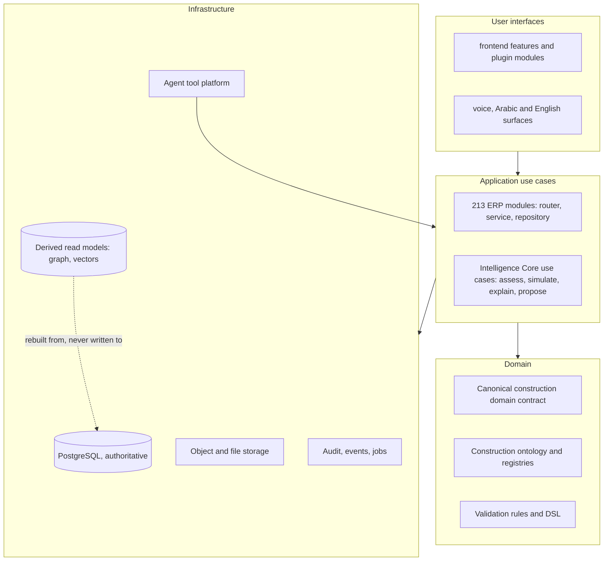
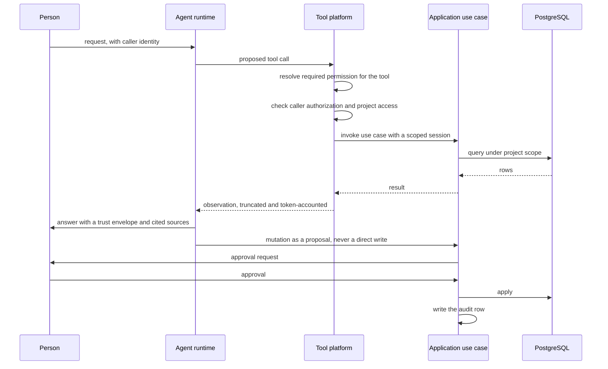

# Target architecture

This page describes the architecture the platform is being taken toward: an intelligence
layer over OpenConstructionERP that can reason about a construction project, cite its
evidence, and act only through authorized, approved, audited paths. It is a target, not a
description of what exists. What exists is measured in
[FOUNDATION_AUDIT.md](./FOUNDATION_AUDIT.md); what to do about the difference, and in
which order, is in [ROADMAP_STATUS.md](./ROADMAP_STATUS.md).

Nothing on this page has been built. Phase 01 produced documentation only, and the
capability statuses below are read from the audited commit
`999f3f80cf033649e92fc738f7273b7202fd695a`.

## Ground rules

These are constraints, not preferences. Each one exists because violating it produces a
specific failure, named here so the reason survives the decision.

1. **PostgreSQL stays the authoritative business-data source.** A vector index, a graph
   projection or a cache is a derived read model. It is rebuildable from the relational
   data, it carries provenance for every element, and it never becomes the place a
   business fact is first written. If a derived store is unavailable, the platform
   degrades to the relational path; it does not serve stale authority. The existing
   vector search already behaves this way, booting without a reachable backend and
   disabling only semantic features.
2. **Agents never execute SQL and never hold a database session.** An agent reaches data
   only by calling a declared tool, and a tool calls an application use case, which owns
   the session, the scope and the permission check. This is the single control that makes
   the rest enforceable: with no session in an agent's hands, there is no path by which a
   prompt can become a query.
3. **Every consequential conclusion is traceable to evidence.** The mechanism already
   exists and is not to be reinvented: `TrustEnvelope` in
   `backend/app/modules/ai_agents/trust.py` carries a calibrated confidence, a rationale,
   `sources` cited by real id or path, and `what_would_increase_confidence`. A conclusion
   without a resolvable source is presented as a hypothesis, never as a finding.
4. **Sensitive operations require authorization, approval, tenant isolation and an audit
   row.** The propose-then-apply pattern in `ai_agents/proposals.py` is the model: the
   machine produces a proposal, a person applies it, and the application records both.
5. **The intelligence layer stays logically separate from ERP internals.** It consumes
   published contracts, not private modules. This is a licensing requirement as much as an
   engineering one: the platform is AGPL-3.0 and any proprietary layer must reach it
   across a boundary the licence permits.
6. **Layer separation is explicit.** Domain logic, application use cases, infrastructure
   and user interfaces are distinguishable by where they live, not by convention in a
   reviewer's head.
7. **Nothing is weakened to make a build green.** Tests, guards, dependency policy and
   security controls are load-bearing. 1,819 backend unit test files, 334 integration
   files, 1,196 frontend test files and 69 `check_*` guards all keep passing through
   every phase.

## Layering

The audit found the layering to be real in intent and blurred in one place: `app/core/`
holds both framework code and construction-domain code side by side (`cpm.py`,
`boq_target.py`, `cde_states.py`, `classification_registry.py`, `country_coverage.py`
alongside `module_loader.py`, `events.py`, `storage.py`). The target keeps the module
system, which is the platform's best structural idea, and gives the domain a name of its
own.

| Layer | Target home | Existing foundation |
|---|---|---|
| Domain | A published, versioned contract for the canonical construction entities, plus the ontology and rule set | 788 models and 9,172 columns; `core/validation/` at 18,767 lines; `classification_registry.py`, `code_lists/`, `country_registries.py`; the canonical JSON format behind [ADR-002](../adr/002-no-ifcopenshell-ddc-canonical-only.md) |
| Application use cases | One module per capability, router plus service plus repository, as today | 213 manifests, 4,627 routes, 4,120 schemas; the loader mounts and registers them |
| Infrastructure | Sessions, storage, derived stores, tool execution, audit, events, jobs | `database.py`, `storage.py` at 1,830 lines, `match_service/` at 7,803 lines, `job_runner.py`, `events.py`, `audit_log.py` |
| User interfaces | Feature folders and plugin modules, both hand-registered | 208 features, 318 routes, 154 sidebar rows, 16 plugin manifests, 45 locale files |

The Intelligence Core is a **separate package** that depends on the domain contract and on
application use cases reached through declared tools and the public API. It does not
import `app.core` or `app.modules` internals. That rule is what keeps an AGPL platform and
a proprietary reasoning layer compatible, and it is testable: an import-lint guard over the
Core package fails on any `app.*` import that is not in the published contract.

## The fourteen capabilities

Status values are the audit's: **Implemented**, **Partial**, **Placeholder**,
**Documentation-only**, **Unverified**. "Reuse" names the existing code the capability is
built on, because building a parallel mechanism next to a working one is the most
expensive mistake available here.

| # | Capability | Today | Reuse | Gap to close | Phase |
|---|---|---|---|---|---|
| 1 | Canonical Construction Domain | **Partial** | canonical JSON from the converter pipeline; 788 models; the generated architecture manifest | The canonical form exists for CAD and BIM inputs but there is no single versioned contract covering projects, cost, schedule, procurement, documents and site records together | 02 |
| 2 | Construction Ontology | **Partial** | `core/validation/` rules and DSL, `classification_registry.py`, `code_lists/`, `country_registries.py`, `data/bim_rules`, 50 regional packs | Knowledge is encoded as validation rules and registries rather than as an explicit ontology with typed relations, so it can check data but cannot be queried for meaning | 03 |
| 3 | Project Intelligence Graph | **Placeholder** | `project_intelligence` (4,899 lines), the manifest's `dependency_graph` over 215 modules, `retrieval` facet query | RFC 25 records the honest position: scoring is "13 hardcoded if-then rules", with "no ML, no anomaly detection, no forecast". There is no entity graph over project data | 03 |
| 4 | Evidence Graph | **Partial** | `TrustEnvelope` and its `Source` type citing real ids and paths; the CDE with versioning, transmittals and approvals; `claims_evidence` | Sources are cited per answer but not linked into a queryable graph, so "what supports this" cannot be traversed | 03 |
| 5 | Dependency Engine | **Partial** | module `depends` and `optional_depends`; the manifest's dependency graph; `core/cpm.py` for schedule logic; `interface_management` | Dependencies resolve for module loading and for schedule networks. There is no cross-domain dependency resolution, so a cost change cannot be traced to the drawing and activity it came from | 04 |
| 6 | Impact Engine | **Partial** | `change_intelligence` (24 files, 10,720 lines), `clash_cost_impact`, `variations`, `eac`, `full_evm`, `cost_recovery`, `estimate_rollup` | Impact is computed inside individual domains. There is no propagation across cost, schedule, procurement and risk from one originating event | 04 |
| 7 | Risk Intelligence Engine | **Partial** | `risk` (14 files, 4,763 lines), `project_intelligence/scorer.py`, `ai_agents/accuracy_service.py` calibration scoreboard | A register with rule-based scoring. No quantitative exposure, no learning from recorded outcomes, although the scoreboard already stores the outcomes needed to start | 04 |
| 8 | What-If Simulation | **Partial** | BOQ what-if scenarios, `postcalc`, `estimate_rollup`, `cost_scope`, `schedule_advanced` | Simulation is local to cost and to schedule. No unified scenario object that holds a set of assumptions and reports their combined effect | 05 |
| 9 | Decision Support | **Partial** | `project_intelligence/advisor.py` and `actions.py`, `AIAdvisorPanel.tsx`, `estimate_reviewer`, `advisors` agent | Advice is generated; it is not ranked against alternatives, and RFC 25 notes the advisor panel falls back to rule text | 05 |
| 10 | Proactive Intelligence | **Partial** | `ai_agents/triggers.py` with `EventTrigger` and `required_permission_for_tool`, `scheduler.py`, `core/events.py` at 513 lines, `notifications` | The trigger and scheduling machinery exists. What is missing is the detection layer that decides something is worth raising before a person asks | 05 |
| 11 | Construction AI Agent | **Implemented** (domain-scoped) | `ai_agents/base.py` agent loop, 8 agents under `agents/`, `llm.py` bridge, `sandbox.py`, `proposals.py` | Agents work within their own domains. There is no cross-domain planning agent, and no single place where an agent's authority is defined | 03 |
| 12 | Agent Tool Platform | **Partial** | `ToolRegistry`, `Tool` protocol, `FunctionTool`, `__agent_context__` injection, observation truncation, per-step timeouts, token accounting | The registry executes tools but does not govern them: no typed tool contract published from the API, no enforced permission check at call time, no per-tool tenant scoping, no quota or cost accounting per caller | 03 |
| 13 | AI Authorization and Human Approval | **Partial** | `RequirePermission` at the router edge, `agents/_access.py::assert_user_can_access_project`, `required_permission_for_tool`, `proposals.py` apply flow, `approval_routes`, the audit log | Authorization is checked at the HTTP edge and, by convention, inside tools. Approval exists for BOQ proposals. Neither is a platform-level policy that every mutation must pass, and the inference declaration that would make machine-derived surfaces enumerable is used by 9 of 213 manifests | 02 |
| 14 | Multimodal Construction AI | **Partial** | `match_service/` extractors including DWG, `cv` module, `pdf_paint_scan.py`, `inbound_capture`, `voice`, `core/translation/llm_translator.py`, 45 locale files with RTL and Hijri support | Images, drawings and documents are processed for matching and takeoff. There is no unified multimodal ingestion path that produces evidence-linked, cited observations | 05 |

### Reading the table honestly

Two rows are worth calling out because the labels could mislead in either direction.

Row 11 is **Implemented** only in the sense that a real agent runtime with a real tool
loop, real observation bounding and real domain agents exists and is tested. It is not a
general construction agent, and it does not plan across domains.

Rows 3 and 7 are the ones a reader is most likely to assume are further along than they
are, because the module names promise more than the code delivers. The evidence for that
is not an outside opinion: it is
[RFC 25](../rfc/25-project-intelligence-audit.md), written inside this repository, which
describes project intelligence as a readiness checklist driven by hardcoded rules. Any
later phase that claims a graph or a risk engine has to point at new code, not at these
modules.

## Lifecycle workflows

The intelligence layer has to serve the workflows a contractor actually runs. Each row
states what the platform already does, because in most cases the answer is "a great deal",
and the intelligence requirement is to connect what exists rather than to replace it.

| Workflow | Already in the platform | What intelligence must add |
|---|---|---|
| Company knowledge and historical projects | `catalog`, `cost_match`, `price_index`, `match_service`, 78 MB of seed catalogues under `data/`, 50 regional packs | Retrieval over the company's own past projects with cited provenance, so a rate is justified by the job it came from |
| Documents | CDE with `file_versions`, `file_approvals`, `file_transmittals`, `signing`, `record_publishing`, `opencde_api` | Evidence-linked extraction: a fact asserted from a document carries the document, version and location |
| Drawings and models | canonical conversion of DWG, DGN, RVT and IFC inputs, `bim_hub`, `bcf`, `clash`, `coordination_hub`, `pointcloud`, `takeoff`, `dwg_takeoff` | Geometry-aware queries answered against the canonical form, with the source element cited |
| Schedules | `schedule`, `schedule_advanced`, `timeline`, `deadlines`, `core/cpm.py` | Delay reasoning that links an activity to the cost and procurement consequences of its float |
| Costs | the deepest area in the platform: BOQ, cost planning, estimate rollup, EAC, EVM, CVR, reconciliation | Variance explanation with attribution, and simulation across assumptions |
| Procurement | `procurement`, `supplier_catalogs`, `subcontractors`, `rfq_bidding`, `tendering`, `commitment_release` | Supplier and price concentration analysis, award recommendation with the comparison it rests on |
| Site operations | `site_supervision`, `fieldreports`, `daily_diary`, `inspections`, `punchlist`, `hse_frame`, `qms`, `ncr` | Pattern detection across diaries and inspections, with the records cited, feeding risk and claims |
| Risk and claims | `risk`, `changeorders`, `variations`, `change_intelligence`, `claims_evidence` | Quantified exposure and an assembled claim narrative where every element resolves to a record |

## Voice, language and long-running context

The stated long-term vision includes voice interaction, Arabic and English operation,
image and document understanding, and continuity across a project's life.

What the platform already supports: 45 locale files with 44 languages offered, guarded by
twelve locale-specific checks; right-to-left and Hijri calendar handling through
`arabic-reshaper`, `python-bidi` and `hijridate` as base dependencies; an LLM translation
path in `core/translation/llm_translator.py`; and a `voice` module.

What is **not** evidenced and must not be assumed: there is no verified speech-recognition
or speech-synthesis pipeline in this tree, and no long-term conversational memory across
sessions. `erp_chat` exists as a module and was not assessed deeply enough here to
classify its retention behaviour; it is marked **Unverified** for that specific question.
Any phase that promises voice interaction starts by establishing that boundary, and the
audio path stays outside the authoritative data store: a transcript is evidence, the
relational record it refers to remains the fact.

Arabic and English are treated as equal first-class surfaces, not as a translation of one
into the other. That has an architectural consequence worth stating early: every
intelligence output that a person reads must carry its locale, its directionality and its
evidence citations together, so a cited source resolves correctly in both languages.

## The agent execution contract

This is the part of the target architecture that has to be right before any new agent is
written, because retrofitting authority onto running agents is how platforms end up with
tools that can read everything.

The contract in words:

1. **A tool is a declared use case, not a query.** Its schema says what it takes and what
   it returns; its registration says which permission it requires.
2. **The platform checks, the tool does not have to remember.** `__agent_context__`
   already carries the invoking user and project; the change is that the registry enforces
   `required_permission_for_tool` and project access before invoking, using
   `agents/_access.py::assert_user_can_access_project` rather than leaving the call to each
   tool's discretion.
3. **Reads are scoped at the use-case layer**, which is where `cost_scope` and project
   scoping already live, and every read is bounded, as `retrieval` already bounds reads
   per source.
4. **Writes are proposals.** `proposals.py` is the pattern: extract, validate (it already
   rejects cross-currency applies), present, and let a person apply.
5. **Every run is recorded** with its trust envelope, its trigger source and its outcome,
   which `oe_ai_agents_run` already stores and `accuracy_service.py` already scores. That
   table is the seed of the calibration evidence, and it is the reason the accuracy
   scoreboard can exist at all.
6. **Observations are bounded** before re-entering the model context, as `_truncate_observation`
   already does, and token use is accounted per step.

## Derived stores

The graph and vector stores are projections. Three rules keep them honest:

- **Rebuildable.** Either can be dropped and reconstructed from PostgreSQL and object
  storage without loss of a business fact. A rebuild is a supported operation, not a
  recovery of last resort.
- **Provenanced.** Every node, edge and embedding records the source rows and the
  document versions it was derived from, so a conclusion can be walked back to evidence.
  This is what makes rule 3 of the ground rules enforceable rather than aspirational.
- **Versioned against the domain contract.** When the canonical contract changes, the
  projection is rebuilt, and the projection carries the contract version it was built
  from. A stale projection is detectable, which is more than can be said for a stale
  prose count in a documentation page.

## What Phase 01 did not do

No code was written, no module was added, no dependency was changed, no schema was
touched, and no existing behaviour was altered. The three documents in this directory are
the whole output. The capability statuses above are the audit's reading of existing code,
not a claim about anything new, and the phasing is a proposal to be confirmed against
evidence as each phase begins.
