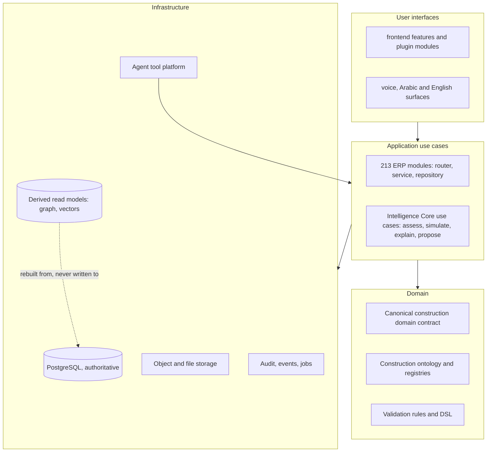
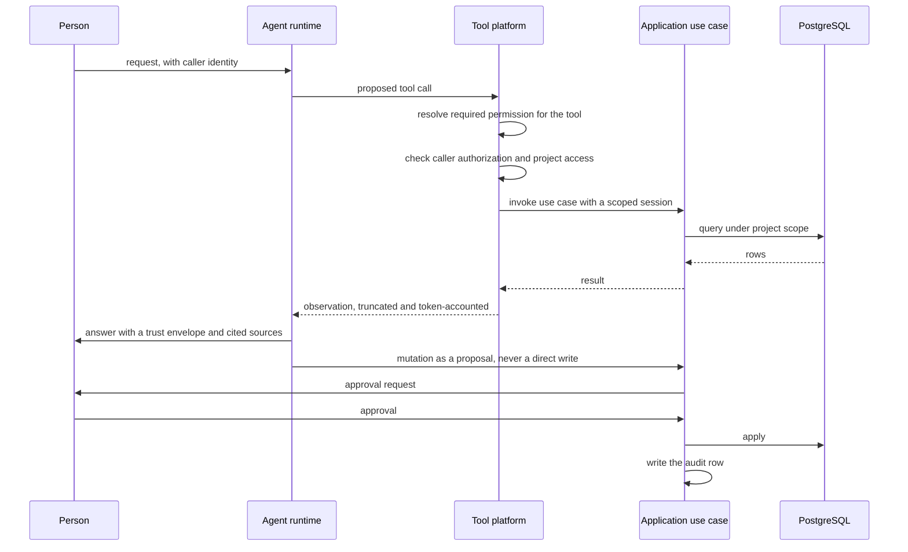

# Target architecture

This page describes the architecture the platform is being taken toward: an intelligence
layer over OpenConstructionERP that can reason about a construction project, cite its
evidence, and act only through authorized, approved, audited paths. It is a target, not a
description of what exists. What exists is measured in
[FOUNDATION_AUDIT.md](./FOUNDATION_AUDIT.md); what to do about the difference, and in
which order, is in [ROADMAP_STATUS.md](./ROADMAP_STATUS.md).

Nothing on this page has been built. Phase 01 produced documentation only, and the
capability statuses below are read from the audited commit
`999f3f80cf033649e92fc738f7273b7202fd695a`.

## Ground rules

These are constraints, not preferences. Each one exists because violating it produces a
specific failure, named here so the reason survives the decision.

1. **PostgreSQL stays the authoritative business-data source.** A vector index, a graph
   projection or a cache is a derived read model. It is rebuildable from the relational
   data, it carries provenance for every element, and it never becomes the place a
   business fact is first written. If a derived store is unavailable, the platform
   degrades to the relational path; it does not serve stale authority. The existing
   vector search already behaves this way, booting without a reachable backend and
   disabling only semantic features.
2. **Agents never execute SQL and never hold a database session.** An agent reaches data
   only by calling a declared tool, and a tool calls an application use case, which owns
   the session, the scope and the permission check. This is the single control that makes
   the rest enforceable: with no session in an agent's hands, there is no path by which a
   prompt can become a query.
3. **Every consequential conclusion is traceable to evidence.** The mechanism already
   exists and is not to be reinvented: `TrustEnvelope` in
   `backend/app/modules/ai_agents/trust.py` carries a calibrated confidence, a rationale,
   `sources` cited by real id or path, and `what_would_increase_confidence`. A conclusion
   without a resolvable source is presented as a hypothesis, never as a finding.
4. **Sensitive operations require authorization, approval, tenant isolation and an audit
   row.** The propose-then-apply pattern in `ai_agents/proposals.py` is the model: the
   machine produces a proposal, a person applies it, and the application records both.
5. **The intelligence layer stays logically separate from ERP internals.** It consumes
   published contracts, not private modules. This is a licensing requirement as much as an
   engineering one: the platform is AGPL-3.0 and any proprietary layer must reach it
   across a boundary the licence permits.
6. **Layer separation is explicit.** Domain logic, application use cases, infrastructure
   and user interfaces are distinguishable by where they live, not by convention in a
   reviewer's head.
7. **Nothing is weakened to make a build green.** Tests, guards, dependency policy and
   security controls are load-bearing. 1,819 backend unit test files, 334 integration
   files, 1,196 frontend test files and 69 `check_*` guards all keep passing through
   every phase.

## Layering

The audit found the layering to be real in intent and blurred in one place: `app/core/`
holds both framework code and construction-domain code side by side (`cpm.py`,
`boq_target.py`, `cde_states.py`, `classification_registry.py`, `country_coverage.py`
alongside `module_loader.py`, `events.py`, `storage.py`). The target keeps the module
system, which is the platform's best structural idea, and gives the domain a name of its
own.

| Layer | Target home | Existing foundation |
|---|---|---|
| Domain | A published, versioned contract for the canonical construction entities, plus the ontology and rule set | 788 models and 9,172 columns; `core/validation/` at 18,767 lines; `classification_registry.py`, `code_lists/`, `country_registries.py`; the canonical JSON format behind [ADR-002](../adr/002-no-ifcopenshell-ddc-canonical-only.md) |
| Application use cases | One module per capability, router plus service plus repository, as today | 213 manifests, 4,627 routes, 4,120 schemas; the loader mounts and registers them |
| Infrastructure | Sessions, storage, derived stores, tool execution, audit, events, jobs | `database.py`, `storage.py` at 1,830 lines, `match_service/` at 7,803 lines, `job_runner.py`, `events.py`, `audit_log.py` |
| User interfaces | Feature folders and plugin modules, both hand-registered | 208 features, 318 routes, 154 sidebar rows, 16 plugin manifests, 45 locale files |

The Intelligence Core is a **separate package** that depends on the domain contract and on
application use cases reached through declared tools and the public API. It does not
import `app.core` or `app.modules` internals. That rule is what keeps an AGPL platform and
a proprietary reasoning layer compatible, and it is testable: an import-lint guard over the
Core package fails on any `app.*` import that is not in the published contract.

## The fourteen capabilities

Status values are the audit's: **Implemented**, **Partial**, **Placeholder**,
**Documentation-only**, **Unverified**. "Reuse" names the existing code the capability is
built on, because building a parallel mechanism next to a working one is the most
expensive mistake available here.

| # | Capability | Today | Reuse | Gap to close | Phase |
|---|---|---|---|---|---|
| 1 | Canonical Construction Domain | **Partial** | canonical JSON from the converter pipeline; 788 models; the generated architecture manifest | The canonical form exists for CAD and BIM inputs but there is no single versioned contract covering projects, cost, schedule, procurement, documents and site records together | 02 |
| 2 | Construction Ontology | **Partial** | `core/validation/` rules and DSL, `classification_registry.py`, `code_lists/`, `country_registries.py`, `data/bim_rules`, 50 regional packs | Knowledge is encoded as validation rules and registries rather than as an explicit ontology with typed relations, so it can check data but cannot be queried for meaning | 03 |
| 3 | Project Intelligence Graph | **Placeholder** | `project_intelligence` (4,899 lines), the manifest's `dependency_graph` over 215 modules, `retrieval` facet query | RFC 25 records the honest position: scoring is "13 hardcoded if-then rules", with "no ML, no anomaly detection, no forecast". There is no entity graph over project data | 03 |
| 4 | Evidence Graph | **Partial** | `TrustEnvelope` and its `Source` type citing real ids and paths; the CDE with versioning, transmittals and approvals; `claims_evidence` | Sources are cited per answer but not linked into a queryable graph, so "what supports this" cannot be traversed | 03 |
| 5 | Dependency Engine | **Partial** | module `depends` and `optional_depends`; the manifest's dependency graph; `core/cpm.py` for schedule logic; `interface_management` | Dependencies resolve for module loading and for schedule networks. There is no cross-domain dependency resolution, so a cost change cannot be traced to the drawing and activity it came from | 04 |
| 6 | Impact Engine | **Partial** | `change_intelligence` (24 files, 10,720 lines), `clash_cost_impact`, `variations`, `eac`, `full_evm`, `cost_recovery`, `estimate_rollup` | Impact is computed inside individual domains. There is no propagation across cost, schedule, procurement and risk from one originating event | 04 |
| 7 | Risk Intelligence Engine | **Partial** | `risk` (14 files, 4,763 lines), `project_intelligence/scorer.py`, `ai_agents/accuracy_service.py` calibration scoreboard | A register with rule-based scoring. No quantitative exposure, no learning from recorded outcomes, although the scoreboard already stores the outcomes needed to start | 04 |
| 8 | What-If Simulation | **Partial** | BOQ what-if scenarios, `postcalc`, `estimate_rollup`, `cost_scope`, `schedule_advanced` | Simulation is local to cost and to schedule. No unified scenario object that holds a set of assumptions and reports their combined effect | 05 |
| 9 | Decision Support | **Partial** | `project_intelligence/advisor.py` and `actions.py`, `AIAdvisorPanel.tsx`, `estimate_reviewer`, `advisors` agent | Advice is generated; it is not ranked against alternatives, and RFC 25 notes the advisor panel falls back to rule text | 05 |
| 10 | Proactive Intelligence | **Partial** | `ai_agents/triggers.py` with `EventTrigger` and `required_permission_for_tool`, `scheduler.py`, `core/events.py` at 513 lines, `notifications` | The trigger and scheduling machinery exists. What is missing is the detection layer that decides something is worth raising before a person asks | 05 |
| 11 | Construction AI Agent | **Implemented** (domain-scoped) | `ai_agents/base.py` agent loop, 8 agents under `agents/`, `llm.py` bridge, `sandbox.py`, `proposals.py` | Agents work within their own domains. There is no cross-domain planning agent, and no single place where an agent's authority is defined | 03 |
| 12 | Agent Tool Platform | **Partial** | `ToolRegistry`, `Tool` protocol, `FunctionTool`, `__agent_context__` injection, observation truncation, per-step timeouts, token accounting | The registry executes tools but does not govern them: no typed tool contract published from the API, no enforced permission check at call time, no per-tool tenant scoping, no quota or cost accounting per caller | 03 |
| 13 | AI Authorization and Human Approval | **Partial** | `RequirePermission` at the router edge, `agents/_access.py::assert_user_can_access_project`, `required_permission_for_tool`, `proposals.py` apply flow, `approval_routes`, the audit log | Authorization is checked at the HTTP edge and, by convention, inside tools. Approval exists for BOQ proposals. Neither is a platform-level policy that every mutation must pass, and the inference declaration that would make machine-derived surfaces enumerable is used by 9 of 213 manifests | 02 |
| 14 | Multimodal Construction AI | **Partial** | `match_service/` extractors including DWG, `cv` module, `pdf_paint_scan.py`, `inbound_capture`, `voice`, `core/translation/llm_translator.py`, 45 locale files with RTL and Hijri support | Images, drawings and documents are processed for matching and takeoff. There is no unified multimodal ingestion path that produces evidence-linked, cited observations | 05 |

### Reading the table honestly

Two rows are worth calling out because the labels could mislead in either direction.

Row 11 is **Implemented** only in the sense that a real agent runtime with a real tool
loop, real observation bounding and real domain agents exists and is tested. It is not a
general construction agent, and it does not plan across domains.

Rows 3 and 7 are the ones a reader is most likely to assume are further along than they
are, because the module names promise more than the code delivers. The evidence for that
is not an outside opinion: it is
[RFC 25](../rfc/25-project-intelligence-audit.md), written inside this repository, which
describes project intelligence as a readiness checklist driven by hardcoded rules. Any
later phase that claims a graph or a risk engine has to point at new code, not at these
modules.

## Lifecycle workflows

The intelligence layer has to serve the workflows a contractor actually runs. Each row
states what the platform already does, because in most cases the answer is "a great deal",
and the intelligence requirement is to connect what exists rather than to replace it.

| Workflow | Already in the platform | What intelligence must add |
|---|---|---|
| Company knowledge and historical projects | `catalog`, `cost_match`, `price_index`, `match_service`, 78 MB of seed catalogues under `data/`, 50 regional packs | Retrieval over the company's own past projects with cited provenance, so a rate is justified by the job it came from |
| Documents | CDE with `file_versions`, `file_approvals`, `file_transmittals`, `signing`, `record_publishing`, `opencde_api` | Evidence-linked extraction: a fact asserted from a document carries the document, version and location |
| Drawings and models | canonical conversion of DWG, DGN, RVT and IFC inputs, `bim_hub`, `bcf`, `clash`, `coordination_hub`, `pointcloud`, `takeoff`, `dwg_takeoff` | Geometry-aware queries answered against the canonical form, with the source element cited |
| Schedules | `schedule`, `schedule_advanced`, `timeline`, `deadlines`, `core/cpm.py` | Delay reasoning that links an activity to the cost and procurement consequences of its float |
| Costs | the deepest area in the platform: BOQ, cost planning, estimate rollup, EAC, EVM, CVR, reconciliation | Variance explanation with attribution, and simulation across assumptions |
| Procurement | `procurement`, `supplier_catalogs`, `subcontractors`, `rfq_bidding`, `tendering`, `commitment_release` | Supplier and price concentration analysis, award recommendation with the comparison it rests on |
| Site operations | `site_supervision`, `fieldreports`, `daily_diary`, `inspections`, `punchlist`, `hse_frame`, `qms`, `ncr` | Pattern detection across diaries and inspections, with the records cited, feeding risk and claims |
| Risk and claims | `risk`, `changeorders`, `variations`, `change_intelligence`, `claims_evidence` | Quantified exposure and an assembled claim narrative where every element resolves to a record |

## Voice, language and long-running context

The stated long-term vision includes voice interaction, Arabic and English operation,
image and document understanding, and continuity across a project's life.

What the platform already supports: 45 locale files with 44 languages offered, guarded by
twelve locale-specific checks; right-to-left and Hijri calendar handling through
`arabic-reshaper`, `python-bidi` and `hijridate` as base dependencies; an LLM translation
path in `core/translation/llm_translator.py`; and a `voice` module.

What is **not** evidenced and must not be assumed: there is no verified speech-recognition
or speech-synthesis pipeline in this tree, and no long-term conversational memory across
sessions. `erp_chat` exists as a module and was not assessed deeply enough here to
classify its retention behaviour; it is marked **Unverified** for that specific question.
Any phase that promises voice interaction starts by establishing that boundary, and the
audio path stays outside the authoritative data store: a transcript is evidence, the
relational record it refers to remains the fact.

Arabic and English are treated as equal first-class surfaces, not as a translation of one
into the other. That has an architectural consequence worth stating early: every
intelligence output that a person reads must carry its locale, its directionality and its
evidence citations together, so a cited source resolves correctly in both languages.

## The agent execution contract

This is the part of the target architecture that has to be right before any new agent is
written, because retrofitting authority onto running agents is how platforms end up with
tools that can read everything.

The contract in words:

1. **A tool is a declared use case, not a query.** Its schema says what it takes and what
   it returns; its registration says which permission it requires.
2. **The platform checks, the tool does not have to remember.** *Implemented in Phase 02.*
   `__agent_context__` carries the invoking user and project, and
   `app/modules/ai_agents/tool_authorization.py` enforces `required_permission_for_tool`
   plus project access before the tool is invoked, using
   `agents/_access.py::assert_user_can_access_project` rather than leaving the call to each
   tool's discretion. One correction to how this page first stated it: the check lives in
   `AgentRunner.run`, not in `ToolRegistry`. The registry has no execution method — it is a
   name-to-tool map — and the runner holds the single `await tool.run(...)` statement that
   every supported path reaches. Putting the gate in the registry would have meant giving
   it an execution path of its own, which is how a second, unguarded way to run a tool
   gets invented. Status and evidence are in
   [ROADMAP_STATUS.md](./ROADMAP_STATUS.md#phase-02-delivered).
3. **Reads are scoped at the use-case layer**, which is where `cost_scope` and project
   scoping already live, and every read is bounded, as `retrieval` already bounds reads
   per source.
4. **Writes are proposals.** `proposals.py` is the pattern: extract, validate (it already
   rejects cross-currency applies), present, and let a person apply.
5. **Every run is recorded** with its trust envelope, its trigger source and its outcome,
   which `oe_ai_agents_run` already stores and `accuracy_service.py` already scores. That
   table is the seed of the calibration evidence, and it is the reason the accuracy
   scoreboard can exist at all.
6. **Observations are bounded** before re-entering the model context, as `_truncate_observation`
   already does, and token use is accounted per step.

## Derived stores

The graph and vector stores are projections. Three rules keep them honest:

- **Rebuildable.** Either can be dropped and reconstructed from PostgreSQL and object
  storage without loss of a business fact. A rebuild is a supported operation, not a
  recovery of last resort.
- **Provenanced.** Every node, edge and embedding records the source rows and the
  document versions it was derived from, so a conclusion can be walked back to evidence.
  This is what makes rule 3 of the ground rules enforceable rather than aspirational.
- **Versioned against the domain contract.** When the canonical contract changes, the
  projection is rebuilt, and the projection carries the contract version it was built
  from. A stale projection is detectable, which is more than can be said for a stale
  prose count in a documentation page.

## What Phase 01 did not do

No code was written, no module was added, no dependency was changed, no schema was
touched, and no existing behaviour was altered. The three documents in this directory are
the whole output. The capability statuses above are the audit's reading of existing code,
not a claim about anything new, and the phasing is a proposal to be confirmed against
evidence as each phase begins.

## What Phase 02 added

Two controls, and no new capability. Both are stated here as the contract a later phase
has to respect, because each one changes what "the platform checks this" means.

### Ownership semantics

Canonical ownership is **the project**, applied in the application layer. `project_id`
appears in 416 column declarations across 147 of 169 `models.py` files, and
`core/cost_scope.py` plus `RequestScopeMiddleware` bind the caller so a read inherits the
same visibility rules whether it arrives over HTTP or from a tool. Project-to-tenant is
therefore the boundary that matters for most data, and it is enforced by
`agents/_access.py::assert_user_can_access_project` (owner or team member, fail closed)
rather than by a column.

`tenant_id` is the **database-level backstop**, not the primary model. It exists on 15 of
169 `models.py` files (29 column declarations), and Phase 02 deliberately did not add it
anywhere else: a column that nothing populates is a policy that hides rows from their
owners. Six tables are explicitly *never* tenant-scoped — `oe_costs_item`,
`oe_costs_catalog`, `oe_catalog_resource`, `oe_regional_indices`, `oe_cost_item_usage`,
`oe_cost_item_resource` — and that exclusion list, not a `tenant_id IS NULL` escape, is how
the platform defines a global record.

**What a tenant actually is, verified in Phase 02.** The value in those columns is the
owning *user's* id. No `tenant_id` claim is issued by any of the six token-minting flows, so
`resolve_tenant_id` always falls through to `sub`; migration `v231_contact_tenant_id`
backfilled `tenant_id = created_by` for that reason and says so; and there is no
organisation entity to derive anything else from, because `User` carries no organisation
reference and `LegalEntity` is a financial entity rather than a tenancy boundary. A strict
policy over that data scopes each user to their own rows, which is right for a one-person
install and wrong for a shared one, so the readiness report refuses it and names
`tenant_is_user`. That refusal is the correct behaviour, not a defect to route around: the
prerequisite is a tenancy entity with a membership relation from `User`, a `tenant_id` claim
issued from it, and a backfill re-pointing the existing values. The evidence chain is in
[ROADMAP_STATUS.md](./ROADMAP_STATUS.md#tenant-identity-what-the-investigation-found).

Two further facts belong to the contract because they constrain any future policy. A
transaction that never bound a tenant keeps the connecting role and is not policied at all,
and the binding has exactly one call site, the global request dependency, so background work
is unpolicied by construction; trusted system work that must see every row belongs under the
`BYPASSRLS` role rather than under a widened policy. And bypassing is a property of the
*role*, not of the session: `oe_system` reads every row with a tenant bound, while `oe_app`
bound to the same tenant reads only its own.

### Database roles

Three roles, and the connecting role is the one to watch:

| Role | Attributes | Used for |
|---|---|---|
| the connecting role | cluster superuser in a default install | migrations, boot-time DDL, and any transaction that never resolved a tenant |
| `oe_app` | `NOSUPERUSER NOINHERIT NOLOGIN` | the policied role; entered with `SET LOCAL ROLE` for the duration of a transaction that carries a tenant |
| `oe_system` | `NOSUPERUSER NOINHERIT NOLOGIN BYPASSRLS` | system work that must see every row |

`verify_rls_role(engine)` raises `RLSConfigurationError` at startup if `oe_app` is missing,
is a superuser, carries `BYPASSRLS`, or cannot be assumed, and it runs outside the
best-effort handler — a mis-provisioned role refuses to boot. The consequence to design
around: **a transaction that never bound a tenant stays on the connecting role and is not
policied at all.** Agent runs and scheduled jobs are exactly that case today.

### Policy semantics

Per table, provisioning issues `ENABLE ROW LEVEL SECURITY`, `FORCE ROW LEVEL SECURITY` (so
the owner is bound too), and a `CREATE POLICY "oe_tenant_isolation"` guarded on
`pg_policies`. Two predicates are available:

- **permissive** — `tenant_id IS NULL OR tenant_id::text = current_setting('app.current_tenant', true)`.
  The rollout mode. A row with no tenant stays visible to everyone, which is what makes a
  first enablement non-breaking and is also why it is not the end state.
- **strict** — `tenant_id::text = current_setting('app.current_tenant', true)`. No NULL arm,
  so an unowned row belongs to nobody, and an empty GUC matches nothing: an anonymous
  caller fails closed rather than widening to every row.

Three consequences were observed on a real PostgreSQL 16 cluster and are part of the
contract, not implementation detail: row-level security that is enabled with no policy at all
denies every row, so a refused strict request must still install the permissive policy; the
strict predicate also governs `WITH CHECK`, so a strict install refuses to *create* a row
with no tenant and cannot grow the backlog it hides; and an unqualified `DELETE FROM t` is
bounded by the policy exactly as a filtered one is.

Strict is honoured only when the readiness report is clean; otherwise provisioning logs the
refusal, reports `strict_refused`, and installs the permissive predicate, so asking for
strict can never leave a table with no policy. Because the guarded `CREATE POLICY` never
replaces an installed one, `apply_rls` reconciles modes explicitly: it drops a policy whose
installed mode differs from the requested one and recreates it. That is what makes turning
strict off a real rollback instead of a no-op. The installed mode is read from
`pg_policies.qual`, and a policy this code cannot classify is left alone — guessing the mode
of an unfamiliar policy in order to drop it is how live data gets hidden.

Provisioning is boot-time DDL under a named advisory lock with `SET LOCAL lock_timeout =
'3s'`, not an Alembic revision; no revision mentions row-level security, and none was added.
Strict mode requires an ownership backfill *before* it is enabled, and the readiness report
is the instrument that measures whether that has happened. Phase 02 performed no data
migration and requires none on the default path.

### The agent authorization gate

`AgentRunner.run` accepts an `authorizer`, and every tool call is decided before the tool is
reached. The decision resolves, in order: whether the arguments tried to name a principal
(`user_id`, `tenant_id`, `actor_id`, `on_behalf_of` — no registered tool takes any of them,
so their presence is an override attempt and is refused rather than ignored); the trusted
principal, from the runner context and never from the arguments; that principal's current
role from the database; the tool's required permission against the real
`PermissionRegistry`; and every project the call names, in the context *and* in the
arguments. Anything missing, unparseable or raising denies, because an unevaluated policy
is not a granted one.

A denial is returned to the model as an observation carrying a stable code
(`authorization_unavailable`, `missing_principal`, `permission_denied`,
`project_access_denied`, `identity_override_rejected`, `policy_error`) and the required
permission — never the reason and never the arguments — and is logged at `WARNING` in the
`ai_agent.tool_denied` structured form. The run continues, so a refusal is something a model
can answer honestly instead of a crash. Denial stays distinguishable from `unknown_tool` and
from a tool that raised, which are different facts about the same call.

Omitting the authorizer does not disable the gate: a tool above the run floor
(`ai_agents.run`) is then denied. Tools at the floor still run, on the strength of the
`RequirePermission` that admitted the run — which is why an unmapped *privileged* tool would
be a bug, and why every registered tool is required to appear in `TOOL_PERMISSIONS`.

### Registering a tool

Three obligations, all checked by tests rather than by review:

1. Name the tool's required permission in `triggers.py::TOOL_PERMISSIONS`. A tool absent
   from the map falls to the run floor and would execute for anyone who can start an agent.
2. Keep identity out of the tool's own parameters. It arrives in `__agent_context__`;
   accepting a `user_id` argument makes the tool the thing the gate refuses.
3. Resolve resource identifiers to their owning project inside the tool. The gate verifies
   the projects a call *names*; only the tool knows that a `boq_id` belongs to one.
   `estimate_reviewer._tool_read_boq` is the pattern: resolve, fail closed without a trusted
   user, and answer `not_found` identically for a denied and a missing resource so the
   response cannot be used to probe.

And a fourth for anyone adding an execution path: pass an authorizer. A test parses the tree
for `.run(...)` calls that supply `context=` and fails if one omits it, so a new entry point
cannot arrive unguarded by accident.
